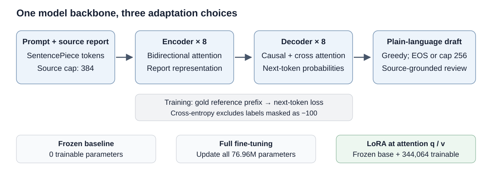
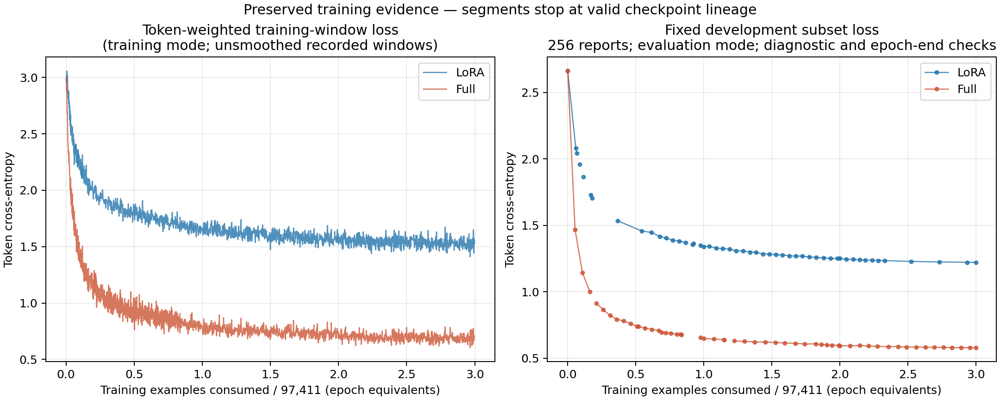

# Radiology reports in plain English

COMP3710 Project 2.6 — William Henry

This prototype rewrites technical radiology reports into language a patient can
understand. It compares untuned FLAN-T5-small, full fine-tuning and rank-8 LoRA
on BioLaySumm LaymanRRG. The engineering question is whether adaptation
preserves findings, negation and diagnostic uncertainty while improving the
rewrite, and whether its computational cost is justified. The intended output
is a draft for review; the clinical safety audit below determines what use the
evidence can support.

## Current experimental status

**Report in progress, 29 October 2026. Final held-out results are pending.**
LoRA has completed three epochs. Full fine-tuning is running toward the same
292,233-example exposure target. The frozen model requires no training.
Development monitoring, feasibility pilots and final evaluation are identified
separately throughout this report. Empty final-result cells do not mean zero.

The practical feasibility check-off has been reported complete by the author.
The one-page review presented on 29 October is reproduced below.

## How the model works

FLAN-T5 is an instruction-tuned encoder–decoder Transformer, building on T5's
text-to-text formulation [1, 2]. The pinned small checkpoint has eight encoder
and eight decoder blocks, model width 512, six attention heads, gated-GELU
feed-forward blocks and relative position attention. The encoder reads the task
prompt and report. During generation, the decoder attends to that representation
and its own previously generated tokens, stopping at EOS or the output cap.
These dimensions come from the pinned checkpoint configuration rather than an
assumption that every model named “T5-small” has identical settings.



Training uses teacher forcing: the decoder receives the reference prefix and
predicts the next reference token. Padding labels are `-100` and contribute no
loss. For valid target-token positions M, the objective is

$$
\mathcal{L}(\theta)=-\frac{1}{|M|}\sum_{(i,t)\in M}
\log p_\theta(y_{i,t}\mid x_i,y_{i,<t}).
$$

The training loop weights accumulated gradients by target-token count, including
short final accumulation groups. A long report therefore contributes more
target tokens than a short report. This is different from giving each report's
mean loss equal weight. A CPU test compares the masked model loss with a direct
cross-entropy calculation.

Full fine-tuning updates all model parameters. LoRA freezes the base model and
adds low-rank updates to attention query and value projections [3]:

$$W'=W+\frac{\alpha}{r}BA,\qquad r=8,\quad\alpha=16.$$

Only A and B are trained; adapter dropout is 0.05. This reduces trainable
parameters and optimizer state, but the frozen base still occupies memory and
must participate in forward/backward computation. Fewer trainable parameters
alone do not guarantee faster generation or better factual faithfulness.

## Data, tokenisation and leakage controls

The dataset is [BioLaySumm2025-LaymanRRG open-source track][dataset], pinned to
revision `6783ab38f9de28c4372799346f51d3927ae7eb9a`. Its raw splits contain
150,454 training pairs and 10,000 validation pairs. The audit found no missing
report/target pairs. Report/image connected components prevent indirect overlap:
42,249 training rows connected to validation are removed, and the remaining
components are split into **97,411 training** and **10,794 development** rows.
All **10,000 official validation rows** retain their original weighting and full
reference rewrites for the final comparison. The challenge test set is unused.

Normalised text is used for overlap checks; the model receives the report text
with its negation and uncertainty wording preserved. Available report/image
identities can be checked, but the data supplies no patient IDs, so these checks
do not establish patient independence. Duplicate/conflicting reference rewrites
are counted in the local audit and are a limitation of reference-based scoring.
Data hygiene and length audits are distinct from model selection: validation is
not used to select checkpoints, decoding or inference batch size.

Every input is prefixed with:

```text
Rewrite this radiology report in plain English. Preserve all findings, negation and uncertainty:
```

The source cap is 384 tokens and the target-training/generation cap is 256.
Training references are truncated for the loss; ROUGE uses the complete saved
reference text. The preliminary training audit found 0.80% of sources and 1.83%
of targets beyond these caps. Final predictions record source truncation,
tokenizer-decoded visible input, token lengths and EOS/cap status so an omission
can be investigated against what was available to the model.

## Training and checkpoint selection

All runs use seed 3710, AdamW with base LR `1e-4`, weight decay 0.01, 5% warm-up,
gradient norm clipping at 1.0, and BF16 autocast on the RTX 3050 Ti Laptop GPU
(4 GiB). Autocast does not imply that every stored weight or optimizer tensor is
BF16. The fixed 256-report monitoring set comes from the training-derived
development split. Checkpoint selection uses eligible epoch-end loss with
`min_delta=0.001` and patience 2. Periodic diagnostics and interrupted-session
evaluations are not new selection decisions.

Both adaptation runs began with microbatch 1 and accumulation 2. LoRA moved to
batch 4 / accumulation 1 after 17,500 exposures; full fine-tuning moved after
81,558 exposures. Continuations restore optimizer/scheduler state, RNG and the
exact shuffled-data cursor. The next LR is preserved, then decay is anchored to
remaining example exposure. These batch transitions change gradient noise and
update frequency; the comparison must disclose that confound even if both runs
finish with the same number of exposures. Three epochs are this experiment's
planned budget, not a universal requirement for effective adaptation.

| Recorded development evidence | Exposures / scope | Token loss |
|---|---|---:|
| Untuned checkpoint | Fixed dev256, before adaptation | 2.662897 |
| LoRA | End of epoch 3; 292,233 training exposures | 1.221684 |
| Full fine-tuning | Selected epoch-one checkpoint; 97,411 exposures | 0.648476 |
| Full fine-tuning | Diagnostic snapshot at 11:12 UTC, 29 October; training still active | 0.626071 |

These measurements establish training progress, not final summary quality or
clinical safety. The loss curve uses cumulative examples seen, divided by
97,411, because optimizer steps differ between batch schedules. Training-window
and evaluation-mode development losses are different quantities. Session
segments and replayed uncheckpointed tails must not be presented as continuous
new exposure.



*Historical/progress snapshot; replace with the completed run curve before final
submission. Raw histories, immutable checkpoint checksums and sampled device
telemetry are retained locally rather than committing training data or weights.*

## Final held-out comparison — pending

Select final immutable checkpoints and a feasible common inference batch using
development data, then lock the settings. The intended primary decoder is
deterministic greedy generation (`beams=1`, no sampling), with the same prompt,
caps, selected validation IDs and reference handling for all three models.

| Model | Validation reports | ROUGE-1 F1 | ROUGE-2 F1 | ROUGE-L F1 | ROUGE-Lsum F1 |
|---|---:|---:|---:|---:|---:|
| Frozen FLAN-T5-small | Pending | Pending | Pending | Pending | Pending |
| Full fine-tuning | Pending | Pending | Pending | Pending | Pending |
| LoRA | Pending | Pending | Pending | Pending | Pending |

ROUGE is the arithmetic mean of per-report F1 values. Stemming is enabled;
explicit sentence boundaries support ROUGE-Lsum. Lexical overlap can reward
fluent wording without detecting a changed clinical fact [4]. Any paired
uncertainty interval describes an aggregate metric comparison, not confidence
that an individual summary is correct.

| Model | Total parameters | Trainable parameters | Training time | Peak training VRAM | Inference latency / tokens/s |
|---|---:|---:|---|---|---|
| Frozen | 76,961,152 | 0 | No adaptation | Not applicable | Pending matched evaluation |
| Full | 76,961,152 | 76,961,152 | Pending completion | Pending completion | Pending matched evaluation |
| LoRA | 77,305,216 | 344,064 | Pending final resource collation | Pending final resource collation | Pending matched evaluation |

Report allocated/reserved Torch peaks separately from sampled whole-device
memory. Generation timing includes each session's first batch; the resumable
driver sums per-batch tokenisation/generation/decoding time and reports GPU
generation time separately. Loading, persistence, scoring and paused gaps are
excluded from those fields. Collate historical failed/replayed compute and
resumed training sessions explicitly rather than counting only the last session.
The existing eight-report, two-update pilots remain feasibility evidence and
will not be substituted for these final results.

## Mandatory clinical safety autopsies — pending outputs

The final report will analyse 3–5 actual held-out failures. Each case needs a
minimal source excerpt, the actual outputs, source evidence and a discussion of
factual faithfulness, acute-finding completeness and layperson readability.
Negation/certainty changes, truncation and capped generation will be considered
where relevant. Selected failures cannot establish the population error rate.

| Case | Actual source/output evidence | Confirmed failure and likely trigger | Readability trade-off |
|---|---|---|---|
| 1 | Pending final generation and review | Pending | Pending |
| 2 | Pending final generation and review | Pending | Pending |
| 3 | Pending final generation and review | Pending | Pending |
| 4–5, if informative | Pending final generation and review | Pending | Pending |

`review_candidates.jsonl` and `research_diagnostics.py` help find cases. Their
small concept/negation regexes have incomplete vocabulary and scope handling;
flags are review prompts, not verified errors. Human/source-grounded review is
still required. No automated clinical judge or calibrated confidence score has
been validated in this experiment.

**Manager recommendation: pending the final comparison and case audit.** The
recommendation must state whether adaptation's measured benefit justifies its
cost, identify unsupported use, and specify concrete review/guardrail needs.
Candidate requirements include preserving uncertainty, checking critical
findings against the source, surfacing truncated/capped cases and routing
outputs for review. Their effectiveness must not be claimed without evaluation.

## Running the project

The code uses Python 3.11.2. Recorded versions are PyTorch 2.8.0+cu126,
Transformers 4.57.1, PEFT 0.17.1, Accelerate 1.10.1, Hugging Face Hub 0.35.3,
SentencePiece 0.2.1, safetensors 0.6.2, PyArrow 21.0.0, NumPy 2.2.6,
rouge-score 0.1.2, NLTK 3.9.2 and Matplotlib 3.10.6. Requirements are pinned in
[requirements.txt](requirements.txt); PyTorch's CUDA wheel is installed
separately following the [official previous-version instructions][torch-install].

Fresh-checkout PowerShell setup, from this project directory:

```powershell
py -3.11 -m venv .venv
.\.venv\Scripts\python.exe -m pip install torch==2.8.0 --index-url https://download.pytorch.org/whl/cu126
.\.venv\Scripts\python.exe -m pip install -r requirements.txt
.\.venv\Scripts\python.exe dataset.py --output data/prepared
.\.venv\Scripts\python.exe prepare_assets.py --revision 0fc9ddf78a1e988dac52e2dac162b0ede4fd74ab
$ModelDir = (Get-Content data/prepared/token_audit.json -Raw | ConvertFrom-Json).local_path
```

For a bounded **smoke run**, not the final training comparison:

```powershell
.\.venv\Scripts\python.exe train.py --mode full --model $ModelDir --revision 0fc9ddf78a1e988dac52e2dac162b0ede4fd74ab --output runs/smoke/full --device cuda --precision bf16 --batch-size 1 --accumulate 2 --train-limit 64 --dev-limit 8 --epochs 1 --max-steps 2
```

Historical full/LoRA launch arguments, immutable checkpoint identities and
transition anchors are stored with each local run. They are necessary to
reconstruct the reported trajectories; the smoke command above is not a claim
to reproduce those trajectories. `modules.py`, `dataset.py`, `train.py` and
`predict.py` contain the model, preprocessing, optimization and saved-model test
driver respectively. Helper modules implement checkpoint integrity, run
supervision, durable prediction batches and CPU analysis.

### Generation after training

See [EVALUATION_PLAN.md](EVALUATION_PLAN.md) for the development-only batching
check. Once settings are frozen, set `$FullCheckpoint`, `$LoRACheckpoint` to
selected immutable best-checkpoint directories and `$InferenceBatch` to the
measured common batch size. Example final invocation:

```powershell
.\.venv\Scripts\python.exe predict.py --manifest data/prepared/evaluation.jsonl --checkpoint $FullCheckpoint --output runs/final/full --device cuda --precision bf16 --batch-size $InferenceBatch --source-length 384 --target-length 256 --beams 1 --evaluation-role final-validation
```

Use the same invocation/output folder with `--resume` after an interruption.
`--max-minutes` can bound a session and pauses after a saved batch; it may change
on resume. Model, manifest, producer-code identity, decoder, batch and precision
must match. The identity also binds actual local binary/safetensors shards and
tokenizer/config files, or the resolved immutable Hub revision. LoRA's external
base is bound separately from its adapter. Effective BF16/FP32, device
capability and CPU/tokenizer thread settings must remain consistent so resumed
resource measurements are not silently labelled with a different runtime.
Completed batches are checksummed and skipped; a failed unpublished
batch may be repeated. Final `predictions.jsonl`, `metrics.json` and review
candidates are produced only after the selected manifest completes. Official
validation runs omit `--limit`. All three final result sets must match in IDs,
row counts and generation settings before comparison.

CPU diagnostics and tests:

```powershell
.\.venv\Scripts\python.exe -m unittest discover -p "test_*.py"
.\.venv\Scripts\python.exe research_diagnostics.py --result runs/final/frozen/metrics.json --result runs/final/full/metrics.json --result runs/final/lora/metrics.json --analyse-predictions --output runs/final-review
.\.venv\Scripts\python.exe plot_research.py --review runs/final-review/review.json --output runs/final-figures
.\.venv\Scripts\python.exe plot_training_history.py --runs-root runs --continuation $FullRunRoot --output runs/training-figure
```

Tests include padding-mask correctness, trainable adapter gradients, saved-model
reload, checkpoint/RNG/cursor continuation, Windows status-sharing behavior and
resumable inference with tiny offline models. Exact floating-point agreement
across different GPUs or library versions is not promised. Data, weights and
generated report exports remain in ignored local directories.

## Feasibility review presented on 29 October 2026

The following reproduces the one-page review presented for the feasibility
check on 29 October 2026. The author reported the check-off successful that
morning. Its preliminary measurements and proposed next steps describe the
state at presentation; subsequent training progress is reported above.

**William Henry | COMP3710 Project 2.6 | Radiology report summarisation | 29 October 2026**

### User Need, Scope & Acceptance Criteria

Patients need readable explanations of radiology reports without invented
findings, missing acute findings or altered diagnostic certainty. This project
studies text-only simplification, aiming for plain, approximately sixth-grade
language; it does not interpret images or provide clinical advice. The central
question is whether task adaptation improves the usefulness of FLAN-T5 summaries
without sacrificing factual fidelity. Acceptance requires:

1. Frozen, full-tuned and LoRA outputs on the same held-out rows, with zero
   audited report/image-identity overlap across splits.
2. ROUGE-1/2/L/Lsum and total/trainable parameters, peak VRAM, runtime and
   inference tokens/s for all applicable runs.
3. A documented audit of 3–5 representative cases, with no invented pathology,
   negation reversal or critical omission as the target, and every failure reported.
4. The same cases scored for jargon, sentence clarity and preserved uncertainty,
   with every unclear output reported.
5. Operation within the local 4 GiB GPU limit without out-of-memory failure.

A small successful case audit would not establish clinical safety.

### Model Choice & Course Concepts

The HARD T5/FLAN-T5 option uses BioLaySumm2025-LaymanRRG-opensource-track
technical-report/lay-rewrite pairs. The audited split contains 97,411 training
and 10,794 development rows; all 10,000 official validation rows are reserved
for final comparison. FLAN-T5-small has 76,961,152 base parameters and an
encoder–decoder Transformer architecture. Full fine-tuning and rank-8 LoRA
start independently from the same pretrained checkpoint. The comparison
applies transfer learning, attention, supervised sequence prediction, masked
cross-entropy, gradient optimisation and low-rank adaptation. Source/target
limits are 384/256 tokens. Transformers/PEFT dependency approval must be
confirmed against the course rules.

### Preliminary Feasibility Evidence

The data audit removed 42,249 validation-connected training rows before
splitting, with no remaining cross-split overlap on the audited identities;
patient independence is unverified. Historical preparation checks recorded
51 passing tests and frozen/full/LoRA inference on eight development examples.
A representative RTX 3050 Ti 4 GB optimiser-step pilot peaked at 1,845 MiB for
full tuning and 975 MiB for LoRA, without an out-of-memory error. These
measurements establish capacity, not final throughput. In logs verified on
20 October, LoRA had completed three epochs; fixed development-subset loss
fell from 2.662897 to 1.221684. Full tuning was paused on 20 October at step
40,779 before its first epoch finished. No final three-way held-out quality
result is available.

### Risks, Budget & Fallback

The main risks are clinically misleading rewrites, truncation,
duplicate/uneven references, overfitting and a batch-size confound: LoRA changed
effective batch 2 to 4, while full tuning stayed at 2. The budget is one local
GPU, no paid compute, and up to three epochs for each adapted model, with
checkpoints and bounded retention. Once continuation is authorised, the next
experiment is to complete full tuning, select checkpoints using development
data, then run the locked three-way evaluation and case audit. If time is
insufficient, a clearly labelled shorter full-tuning run preserves the required
comparison; LoRA-only results do not satisfy it. Unsafe outputs remain research
examples, with source review and clinical sign-off required before any patient use.

## Artificial Intelligence Usage Disclosure

OpenAI ChatGPT/Codex assisted with literature/context lookup, implementation and
refactoring, data/metric audits, tests, training supervision, plotting and report
drafting. Suggestions were checked through split/hash verification, masked-loss
and model-reload tests, optimizer/RNG/cursor continuation tests, bounded GPU
feasibility measurements and retained training logs. Resumable inference was
tested on tiny offline CPU frozen/full/LoRA models, including failures and
unchanged output/order after resume. The author remains responsible for reviewing
the code and report. Final held-out metrics and the clinical case audit are
explicitly pending; this draft does not claim that tests substitute for that
review or that clinical safety has been established.

## Submission completion

Before submission, replace pending results and this progress snapshot with the
completed evidence, confirm citations and exact commands, and review the final
scope. Submit a working PR to `shakes76/PatternAnalysis-2026` targeting
`topic-recognition`, then export the actual README to PDF for Turnitin. The
later teaching-team code-review response remains separately marked: requested
changes and replies must be completed within the announced response window.

## References

1. Raffel et al. (2020), [Exploring the Limits of Transfer Learning with a Unified Text-to-Text Transformer](https://jmlr.org/papers/v21/20-074.html).
2. Chung et al. (2024), [Scaling Instruction-Finetuned Language Models](https://www.jmlr.org/papers/v25/23-0870.html).
3. Hu et al. (2022), [LoRA: Low-Rank Adaptation of Large Language Models](https://arxiv.org/abs/2106.09685).
4. Maynez et al. (2020), [On Faithfulness and Factuality in Abstractive Summarization](https://aclanthology.org/2020.acl-main.173/).
5. [Google FLAN-T5-small model card](https://huggingface.co/google/flan-t5-small), pinned revision `0fc9ddf78a1e988dac52e2dac162b0ede4fd74ab`.
6. [BioLaySumm 2025 task](https://biolaysumm.org/) and [LaymanRRG dataset][dataset].

[dataset]: https://huggingface.co/datasets/BioLaySumm/BioLaySumm2025-LaymanRRG-opensource-track
[torch-install]: https://pytorch.org/get-started/previous-versions/#v280
