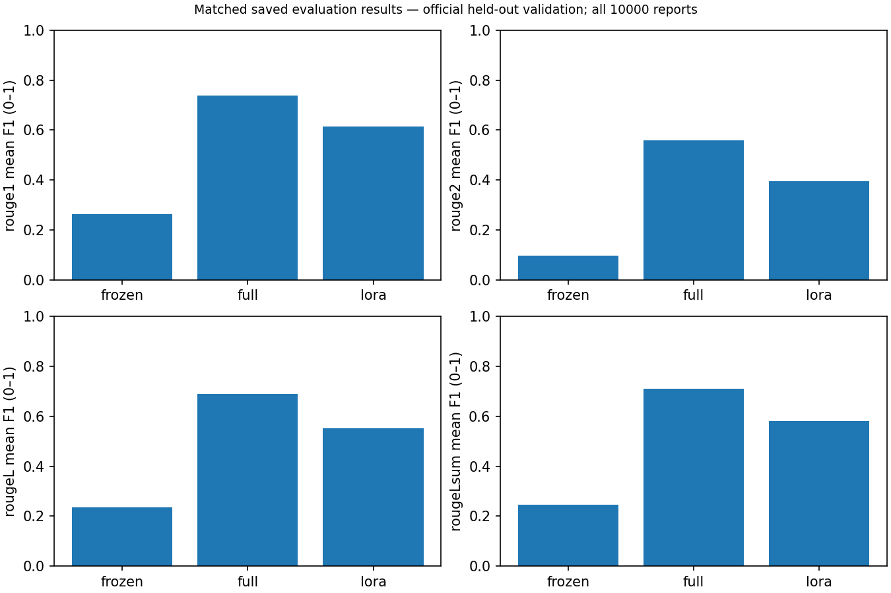
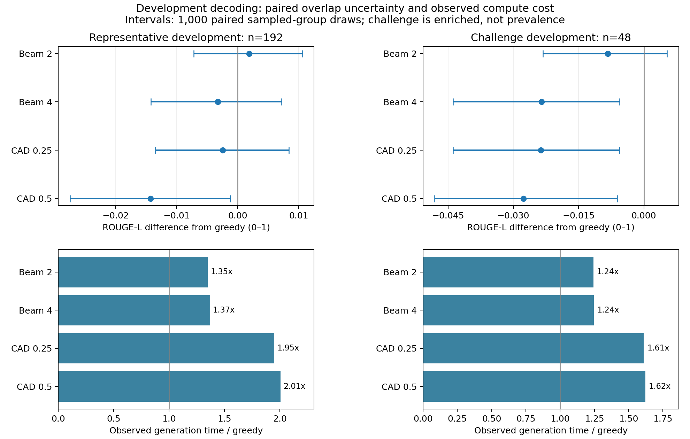
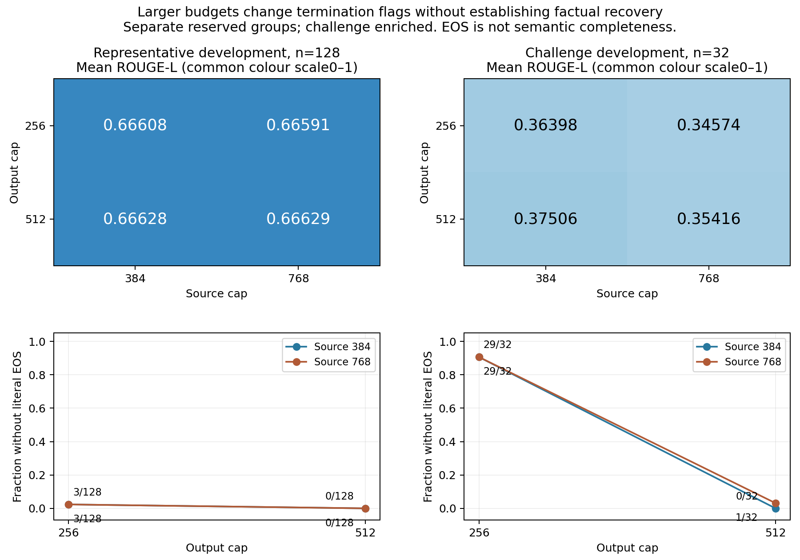
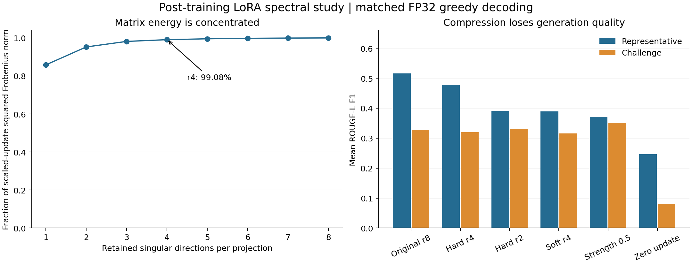
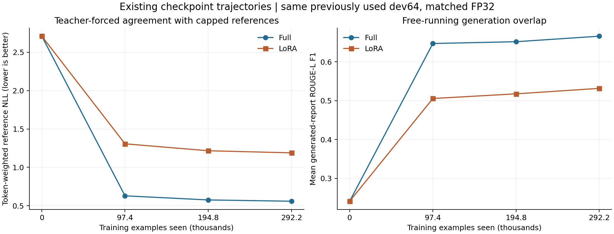
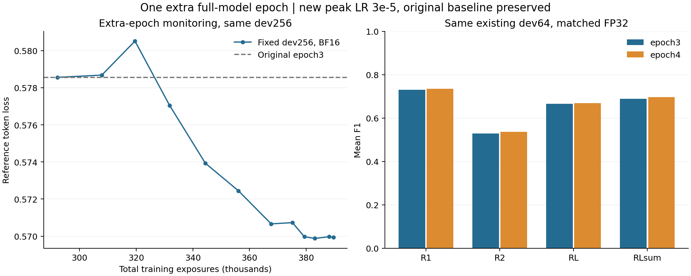

# Radiology reports in plain English

COMP3710 Project 2.6 | William Henry

This prototype rewrites technical radiology reports into language a patient can
understand. It compares untuned FLAN-T5-small, full fine-tuning and rank-8 LoRA
on BioLaySumm LaymanRRG. The engineering question is whether adaptation
preserves findings, negation and diagnostic uncertainty while improving the
rewrite, and whether its computational cost is justified. The intended output
is a draft for review; the clinical safety audit below determines what use the
evidence can support.

## Main findings

Full fine-tuning and LoRA
each completed three epochs and 292,233 training exposures. All three models
were evaluated on the same 10,000 held-out reports. Checkpoint payloads, paired
IDs, visible inputs and final exports were verified. The results support a
prototype comparison, not clinical deployment or calibrated confidence in an
individual rewrite. The frozen model requires no task-specific training.

Full fine-tuning gave the strongest held-out overlap scores: ROUGE-L 0.68952,
compared with 0.55197 for LoRA and 0.23524 for the frozen model. LoRA reduced
trainable parameters substantially, but did not match full tuning's quality or
inference speed in this setup. The failure analysis matters just as much:
fluent outputs still changed uncertainty, anatomy and acquisition limitations.

The first part of this report covers the required model comparison, resources,
case analysis and reproducibility. The research extensions then investigate
decoding, token budgets, adapter spectra, learning trajectories, a fourth
training epoch and learned error detection. The final section sets out the
next studies I would prioritise with more time and compute. The one-page
feasibility review presented on 29 October is included in its original context.

## How the model works

FLAN-T5 is an instruction-tuned encoder–decoder Transformer, building on T5's
text-to-text formulation [1, 2]. The pinned small checkpoint has eight encoder
and eight decoder blocks, model width 512, six attention heads, gated-GELU
feed-forward blocks and relative position attention. The encoder reads the task
prompt and report. During generation, the decoder attends to that representation
and its own previously generated tokens, stopping at EOS or the output cap.
These dimensions come from the pinned checkpoint configuration rather than an
assumption that every model named “T5-small” has identical settings.


Training uses teacher forcing: the decoder receives the reference prefix and
predicts the next reference token. Padding labels are `-100` and contribute no
loss. For valid target-token positions M, the objective is

$$
\mathcal{L}(\theta)=-\frac{1}{|M|}\sum_{(i,t)\in M}
\log p_\theta(y_{i,t}\mid x_i,y_{i,<t}).
$$

The training loop weights accumulated gradients by target-token count, including
short final accumulation groups. A long report therefore contributes more
target tokens than a short report. This is different from giving each report's
mean loss equal weight. A CPU test compares the masked model loss with a direct
cross-entropy calculation.

Full fine-tuning updates all model parameters. LoRA freezes the base model and
adds low-rank updates to attention query and value projections [3]:

$$W'=W+\frac{\alpha}{r}BA,\qquad r=8,\quad\alpha=16.$$

The saved adapter has 48 A matrices of shape 8 x 512 and 48 B matrices of
shape 384 x 8: `48 x 8 x (512 + 384) = 344,064` parameters. Query/value
adaptation spans eight encoder self-attention, eight decoder self-attention
and eight decoder cross-attention modules. Only A and B are trained;
adapter dropout is 0.05. This reduces trainable
parameters and optimizer state, but the frozen base still occupies memory and
must participate in forward/backward computation. Fewer trainable parameters
alone do not guarantee faster generation or better factual faithfulness.

## Data, tokenisation and leakage controls

The dataset is [BioLaySumm2025-LaymanRRG open-source track][dataset], pinned to
revision `6783ab38f9de28c4372799346f51d3927ae7eb9a`. Its raw splits contain
150,454 training pairs and 10,000 validation pairs. The audit found no missing
report/target pairs. Report/image connected components prevent indirect overlap:
42,249 training rows connected to validation are removed, and the remaining
components are split into **97,411 training** and **10,794 development** rows.
All **10,000 official validation rows** retain their original weighting and full
reference rewrites for the final comparison. The challenge test set is unused.

Normalised text is used for overlap checks; the model receives the report text
with its negation and uncertainty wording preserved. Available report/image
identities can be checked, but the data supplies no patient IDs, so these checks
do not establish patient independence. Repeated inputs and differing reference wordings
are counted in the local audit and are a limitation of reference-based scoring.
Data hygiene and length audits are distinct from model selection: validation is
not used to select checkpoints, decoding or inference batch size.

Every input is prefixed with:

```text
Rewrite this radiology report in plain English. Preserve all findings, negation and uncertainty:
```

The source cap is 384 tokens and the target-training/generation cap is 256.
Training references are truncated for the loss; ROUGE uses the complete saved
reference text. The preliminary training audit found 0.80% of sources and 1.83%
of targets beyond these caps. Final predictions record source truncation,
tokenizer-decoded visible input, token lengths and EOS/cap status so an omission
can be investigated against what was available to the model.

## Training and checkpoint selection

Both baseline adaptation runs use seed 3710, AdamW with base LR `1e-4`, weight decay 0.01, 5% warm-up,
gradient norm clipping at 1.0, and BF16 autocast on the RTX 3050 Ti Laptop GPU
(4 GiB). Autocast does not imply that every stored weight or optimizer tensor is
BF16. The fixed 256-report monitoring set comes from the training-derived
development split. Checkpoint selection uses eligible epoch-end loss with
`min_delta=0.001` and patience 2. Periodic diagnostics and interrupted-session
evaluations are not new selection decisions.

Both adaptation runs began with microbatch 1 and accumulation 2. LoRA moved to
batch 4 / accumulation 1 after 17,500 exposures; full fine-tuning moved after
81,558 exposures. Continuations restore optimizer/scheduler state, RNG and the
exact shuffled-data cursor. The next LR is preserved, then decay is anchored to
remaining example exposure. These batch transitions change gradient noise and
update frequency; the comparison must disclose that confound even if both runs
finish with the same number of exposures. Three epochs are this experiment's
planned budget, not a universal requirement for effective adaptation. Full used
93,449 optimizer updates versus 77,434 for LoRA despite equal total exposure.

| Recorded development evidence | Exposures / scope | Token loss |
|---|---|---:|
| Untuned checkpoint | Fixed dev256, before adaptation | 2.662897 |
| LoRA | End of epoch 3; 292,233 training exposures | 1.221684 |
| Full fine-tuning | Selected epoch-one checkpoint; 97,411 exposures | 0.648476 |
| Full fine-tuning | Selected epoch-two checkpoint; 194,822 exposures | 0.594326 |
| Full fine-tuning | Selected epoch-three checkpoint; 292,233 exposures | 0.578559 |

These measurements establish training progress, not final summary quality or
clinical safety. The loss curve uses cumulative examples seen, divided by
97,411, because optimizer steps differ between batch schedules. Training-window
and evaluation-mode development losses are different quantities. Session
segments and replayed uncheckpointed tails must not be presented as continuous
new exposure.


*Completed three-epoch histories. Raw logs, immutable checkpoint checksums and
sampled device telemetry are retained locally; training data and weights are
excluded from Git. Lines remain separate across process/session boundaries.*

## Final held-out comparison

The recipe was locked before held-out generation: selected immutable
checkpoints, batch 64, BF16, greedy decoding (`beams=1`, no sampling), source
cap 384, output cap 256 and seed 3710. Prompt, validation IDs, full references,
effective runtime and all eight producer-file hashes match across models.
The source cap includes the prompt. A separate 64-report development timing
pilot tested batches 4/8/16/32/64 without quality-based selection. Batch 64 was
fastest tested, with at least 2,391 MiB sampled device headroom. BF16 greedy
outputs can change with batch shape, including meaningful wording changes;
the final batch and runtime were therefore fixed, including on resume.

| Model | Validation reports | ROUGE-1 F1 | ROUGE-2 F1 | ROUGE-L F1 | ROUGE-Lsum F1 |
|---|---:|---:|---:|---:|---:|
| Frozen FLAN-T5-small | 10,000 | 0.26450 | 0.09638 | 0.23524 | 0.24556 |
| Full fine-tuning | 10,000 | 0.73844 | 0.55926 | 0.68952 | 0.70882 |
| LoRA | 10,000 | 0.61454 | 0.39429 | 0.55197 | 0.57977 |



ROUGE is the arithmetic mean of per-report F1 values on scale 0-1. Stemming is
enabled; explicit sentence boundaries support union-LCS ROUGE-Lsum. Full
references are scored even where training targets or visible sources exceeded
their caps. Matching words do not establish factual faithfulness [4].

### Paired uncertainty and where performance weakens

All 10,000 original rows retain their weighting. They form 7,599 observable
report/image components; the largest has 289 rows. There are 283 normalised
input groups with multiple reference wordings, which need not be contradictory.
The paired percentile bootstrap resamples whole components with shared draws,
then recomputes row-weighted differences (1,000 draws; seed 3710).

| ROUGE-L difference | Point difference | 95% percentile interval |
|---|---:|---:|
| Full minus frozen | 0.45427 | [0.43075, 0.48046] |
| LoRA minus frozen | 0.31673 | [0.29240, 0.34313] |
| Full minus LoRA | 0.13755 | [0.12045, 0.16223] |

Intervals describe evaluation-sample variation conditional on these trained
models, not training-seed uncertainty, patient independence or per-rewrite
confidence. No repeated-seed experiment was run. Different batch transitions
also prevent attributing the entire full-versus-LoRA gap to adaptation capacity.

| Source length (whitespace words) | Reports | Frozen ROUGE-L | Full ROUGE-L | LoRA ROUGE-L |
|---|---:|---:|---:|---:|
| 0-50 words | 9,188 | 0.24077 | 0.69806 | 0.56207 |
| 51-100 words | 621 | 0.19950 | 0.61836 | 0.46571 |
| >100 words | 191 | 0.08564 | 0.51010 | 0.34655 |

The aggregate is dominated by short reports: 9,188 have at most 50 words and
only 191 exceed 100. Full tuning leads in every reported length bin, but its
ROUGE-L falls from 0.69806 to 0.51010 between those extremes. Length, source
domain and case difficulty are entangled; this is descriptive stratification,
not a causal length effect. Source counts are PadChest 7,824, BIMCV-COVID19
2,042 and OpenI 134, limiting broad cross-domain claims.

### Resources and practical trade-offs

| Model | Total parameters | Trainable parameters | Training lineage time | Peak training allocated / reserved MiB | Sampled training device MiB |
|---|---:|---:|---:|---:|---:|
| Frozen | 76,961,152 | 0 | No task adaptation | Not applicable | Not applicable |
| Full | 76,961,152 | 76,961,152 | 13.60 h | 2687.49 / 3080 | 3266 |
| LoRA | 77,305,216 | 344,064 | 12.16 h | 1893.19 / 2226 | 2337 |

Training lineage time includes development evaluation and checkpointing, while
excluding paused calendar time. It is not total project compute: logged full
process spans including replay total at least 13.87 h, versus 13.60 h along the
retained checkpoint lineage. LoRA's retained lineage is 12.16 h; a superseded
trial consumed additional time. Whole-device samples can miss peaks and include
other processes. Foundation-model pretraining cost is outside this comparison.

| Model | Batch wall / observer session seconds | Median batch generation seconds | Amortised batch wall ms/report | Generated tokens/s | Inference allocated / reserved / sampled-device MiB |
|---|---:|---:|---:|---:|---:|
| Frozen | 587.63 / 620.19 | 4.580 | 58.76 | 663.72 | 1256.31 / 2624 / 2727 |
| Full | 697.12 / 740.42 | 4.528 | 69.71 | 709.04 | 1288.93 / 2530 / 2633 |
| LoRA | 966.33 / 1011.05 | 6.200 | 96.63 | 503.94 | 1257.84 / 2462 / 2565 |

Batch wall sums tokenisation, synchronised generation and decoding, including
each session's first batch; it excludes loading, persistence, scoring and paused
gaps. Observer session time includes those session costs. The median is per
batch, not individual-request latency; amortised ms/report is a throughput
quantity. Generated-token counts exclude padding/decoder start and include EOS.
Outputs average 38.68/49.01/48.41 tokens for frozen/full/LoRA, so reports/s alone
does not isolate model speed. Thermal conditions varied (sampled maxima
75/69/69 degrees C); these are observed costs, not a controlled speedup claim.

LoRA trains about 0.45% of its parameters and reduced recorded allocated
training memory, but the base weights/activations remain. Its adapters were
unmerged during inference, adding operations; lower trainable count did not
produce faster generation here. Both adapted models fitted this 4 GiB GPU.

### Output diagnostics

| Model | Truncated inputs | Outputs without EOS | Empty outputs | Within-output repetition candidates |
|---|---:|---:|---:|---:|
| Frozen | 52 | 119 | 27 | 90 |
| Full | 52 | 115 | 0 | 29 |
| LoRA | 52 | 195 | 0 | 157 |

Empty and unfinished outputs were retained and scored; no held-out setting was
changed to repair them. Repetition candidates require at least 24 words, a
four-word phrase repeated at least three times and duplicate four-gram fraction
at least 0.30. This is a review heuristic, not verified error prevalence.
Repeated complete outputs can also reflect repeated or normal input reports.

The final manifest SHA-256 is
`f3707225785622f24c4b60b412f364a26453c3d4cf92c5d9381e106a5e0d01a0`.
Producer code corresponds to commit `860d28f`; later report-only commits do
not change those eight source hashes. Local checksum batches, metrics, bootstrap
results and immutable checkpoint receipts retain the full numerical provenance.

## Source-grounded failure autopsies

These five failure-selected cases cover different mechanisms, rather than
estimating an error rate. Original source, tokenizer-visible source, full
reference and all three saved outputs were checked. The input/output summaries
below are minimal paraphrases, not substitute inputs used for a new experiment.
Row IDs refer to the pinned official validation split. The pinned dataset card
does not declare a licence; source datasets retain research/sharing conditions
[7]. Original reports, images and bulk predictions remain local.

### validation:69: Entity-attribute misbinding

**Input summary (PadChest; paraphrase):** The source separately describes an elongated aorta, an enlarged heart and a right basal infiltrate compatible with infection.

**Observed outputs:** LoRA retains heart enlargement but additionally turns the right lung finding into lung enlargement. Full tuning preserves the relevant infiltrate/infection relationship; frozen largely copies the technical source and task instruction.

**Trigger and response:** The error fits entity-attribute misbinding across adjacent findings: a fluent sentence attaches an enlargement property to the wrong organ. Capacity, attention and reference-noise contributions were not isolated. Check each finding against its anatomical subject; fluency and shared disease words do not establish the correct relation.

### validation:164: Spatial negation and modifier scope

**Input summary (OpenI; paraphrase):** The source describes normal central airways, patchy lung densities, suspected acute pneumonia and no pneumothorax.

**Observed outputs:** LoRA changes the normal-airway statement into normal lungs and expresses the absent extra-pulmonary air finding as absence of air inside the lungs. Full preserves the relevant spatial negation. Frozen returns mainly the concluding impression, omitting other supplied findings.

**Trigger and response:** This is a relation/scope error, not merely a missing negation token. A normality modifier migrates between structures, and a preposition changes what is being negated. The entire source was visible. Review the negated concept together with its anatomical location; a bag-of-concepts match can miss this failure.

### validation:206: Internal contradiction and anatomical substitution

**Input summary (OpenI; paraphrase):** The source lists a possible right-middle-lobe process, explicitly excludes pleural fluid and notes a raised right hemidiaphragm.

**Observed outputs:** LoRA first adds a small fluid collection and then denies fluid in the next sentence; it also substitutes the right middle lung region for the elevated diaphragm. Full preserves the relevant uncertainty and negation. Frozen keeps only the possible lung-process sentence.

**Trigger and response:** Autoregressive token prediction does not enforce cross-sentence consistency or correct anatomical binding. All relevant statements were visible; the reference also preserves them. No causal decoder/adapter ablation was run. Check for contradictory positive/negative claims and align each anatomical finding to the source.

### validation:3207: Unsupported reassurance and certainty inflation

**Input summary (BIMCV-COVID19; paraphrase):** The source states that acquisition technique reduces diagnostic sensitivity and describes a possible small upper-right opacity.

**Observed outputs:** Full tuning dismisses the acquisition limitation and turns the possible opacity into an unqualified finding. LoRA also drops the opacity qualifier and omits part of the acquisition caveat. Frozen enters a repetitive loop rather than providing a useful rewrite.

**Trigger and response:** This is unfaithful simplification despite a fully visible input. Full achieves ROUGE-L 0.678 on this case, showing that many matching words can coexist with a changed clinical assertion. A learned reassuring style is a hypothesis, not a proven cause. Preserve modality and uncertainty qualifiers explicitly; lexical overlap and completed text are insufficient safety checks.

### validation:195: Separate source and generation budget failures

**Input summary (BIMCV-COVID19; paraphrase):** A long multi-region CT report contains thoracic, abdominal and bone findings; some later findings lie beyond the visible input budget.

**Observed outputs:** The prompted source has 520 tokens but only 384 are visible. Full and LoRA both reach 256 generated tokens without EOS and stop unfinished. Frozen instead links the cut-off organ-name fragment to a lung-tumour label and ends with EOS.

**Trigger and response:** Unseen late findings are an input-visibility limitation, not evidence that the decoder ignored available text. Both adapted outputs also omit available later content because the generation budget is exhausted. The frozen association is an additional unsupported content failure; truncation as its trigger remains a hypothesis. Route truncated or unfinished reports for review; sentence-aware segmentation and larger budgets require development testing. EOS alone cannot certify fidelity.

Across these cases, frozen copies technical text or loops; full usually explains
terms more clearly, but still retains jargon such as the specialised nodule and
lung-region terminology in case 195. LoRA also retains jargon and awkward
phrasing; its contradictory sentences in case 206 undermine clarity. Full's
fluent reassurance in case 3207 illustrates that easier wording can be less
faithful. These are qualitative observations, not measured patient comprehension
or a collected numerical readability score.

### What the flags and scores cannot tell us

The full model's regex flags include false positives: `validation:171` preserves
the source negation, but the limited matcher misses a negative construction in
the output. `validation:127` preserves the source's questionable fracture, but
the matcher does not recognise the source uncertainty cue. Therefore the count
of flagged concepts is not a clinical-error rate. The rules have incomplete
synonyms, negation scope and anatomical relations. Source-grounded textual
review is also not independent radiologist adjudication.

**Manager recommendation:** prefer full tuning for further prototype work:
it has the strongest overlap scores and fitted the local GPU. LoRA offers a
large trainable-parameter reduction and lower recorded training memory, but
lost quality and was slower in this unmerged inference setup. None should
produce unreviewed patient-facing text: even full tuning altered uncertainty
and acquisition limitations. Empty/non-EOS outputs and truncated sources need
explicit review routing; all critical facts, negation and uncertainty need
source comparison before release. EOS is a completion signal, not a fidelity
certificate, as `validation:195` illustrates.

The extensions below investigate several of these failure mechanisms and a
learned error detector. Their scope remains experimental: ROUGE is not a
factuality score, and the learned detector has not been clinically validated
or implemented as a deployment safety system.

## Running the project

The code uses Python 3.11.2. Recorded versions are PyTorch 2.8.0+cu126,
Transformers 4.57.1, PEFT 0.17.1, Accelerate 1.10.1, Hugging Face Hub 0.35.3,
SentencePiece 0.2.1, safetensors 0.6.2, PyArrow 21.0.0, NumPy 2.2.6,
rouge-score 0.1.2, NLTK 3.9.2 and Matplotlib 3.10.6. Requirements are pinned in
[requirements.txt](requirements.txt); PyTorch's CUDA wheel is installed
separately following the [official previous-version instructions][torch-install].

Fresh-checkout PowerShell setup, from this project directory:

```powershell
py -3.11 -m venv .venv
.\.venv\Scripts\python.exe -m pip install torch==2.8.0 --index-url https://download.pytorch.org/whl/cu126
.\.venv\Scripts\python.exe -m pip install -r requirements.txt
.\.venv\Scripts\python.exe dataset.py --output data/prepared
.\.venv\Scripts\python.exe prepare_assets.py --revision 0fc9ddf78a1e988dac52e2dac162b0ede4fd74ab
$ModelDir = (Get-Content data/prepared/token_audit.json -Raw | ConvertFrom-Json).local_path
```

For a bounded **smoke run**, not the final training comparison:

```powershell
.\.venv\Scripts\python.exe train.py --mode full --model $ModelDir --revision 0fc9ddf78a1e988dac52e2dac162b0ede4fd74ab --output runs/smoke/full --device cuda --precision bf16 --batch-size 1 --accumulate 2 --train-limit 64 --dev-limit 8 --epochs 1 --max-steps 2
```

For a fresh replay of the recorded training protocol, use
[TRAINING_REPRODUCTION.md](TRAINING_REPRODUCTION.md), the data-free historical
manifest [configs/historical_training.json](configs/historical_training.json)
and `replay_training.py`. These record the actual batch-transition boundaries,
exposures, scheduler policy and checkpoint identities. The helper checks the
prepared data's canonical content/order hashes and verifies each phase boundary.
From the same PowerShell session:

```powershell
.\.venv\Scripts\python.exe replay_training.py --scenario full --model $ModelDir --data data/prepared --output-root runs/replay-full --plan
.\.venv\Scripts\python.exe replay_training.py --scenario lora --model $ModelDir --data data/prepared --output-root runs/replay-lora --plan
```

The commands print plans without training. After checking them, replace `--plan`
with `--execute` to train each scenario, one at a time. This reconstructs the
recorded protocol; it does not promise identical floating-point outputs across
hardware or claim that these replay commands were the historical launch commands.
Original checkpoints are not distributed. They can be recreated by training;
their published hashes identify the historical artifacts, not downloadable weights.

`modules.py`, `dataset.py`, `train.py` and `predict.py` contain the model,
preprocessing, optimisation and saved-model test driver respectively. Helpers
provide checkpoint integrity, resumable supervision, durable prediction batches
and analysis. A failure or restart must preserve the same data order, model,
optimizer, scheduler and RNG lineage rather than silently begin a new experiment.

### Generation after training

See [EVALUATION_PLAN.md](EVALUATION_PLAN.md) for the development-only batching
check. After the replay commands finish, the following paths refer to their
selected `best` checkpoint aliases. The loader resolves an alias to one immutable
directory and verifies its identity. Batch 64 is the recorded common batch on
this GPU; check feasibility on development data before choosing a different
batch on another device, and then keep it fixed across models.

```powershell
$FullCheckpoint = "runs/replay-full/full-b4/best"
$LoRACheckpoint = "runs/replay-lora/lora-b4/best"
$InferenceBatch = 64
.\.venv\Scripts\python.exe predict.py --manifest data/prepared/evaluation.jsonl --model $ModelDir --revision 0fc9ddf78a1e988dac52e2dac162b0ede4fd74ab --output runs/reproduced/frozen --device cuda --precision bf16 --batch-size $InferenceBatch --source-length 384 --target-length 256 --beams 1 --evaluation-role final-validation
.\.venv\Scripts\python.exe predict.py --manifest data/prepared/evaluation.jsonl --checkpoint $FullCheckpoint --output runs/reproduced/full --device cuda --precision bf16 --batch-size $InferenceBatch --source-length 384 --target-length 256 --beams 1 --evaluation-role final-validation
.\.venv\Scripts\python.exe predict.py --manifest data/prepared/evaluation.jsonl --checkpoint $LoRACheckpoint --output runs/reproduced/lora --device cuda --precision bf16 --batch-size $InferenceBatch --source-length 384 --target-length 256 --beams 1 --evaluation-role final-validation
```

These are fresh output directories. Historical predictions retain their original
producer hashes and are not overwritten or relabelled by a newer code version.
For a quick development test, change the manifest to `data/prepared/dev.jsonl`,
choose a fresh output path, use `--evaluation-role development-pilot` and a small
`--limit`. A limited run is not the final 10,000-row comparison.

Use the same invocation/output folder with `--resume` after an interruption.
`--max-minutes` can bound a session and pauses after a saved batch; it may change
on resume. Model, manifest, producer-code identity, decoder, batch and precision
must match. The identity also binds actual local binary/safetensors shards and
tokenizer/config files, or the resolved immutable Hub revision. LoRA's external
base is bound separately from its adapter. Effective BF16/FP32, device
capability and CPU/tokenizer thread settings must remain consistent so resumed
resource measurements are not silently labelled with a different runtime.
Long evaluation jobs can use `supervise_prediction.py` for process/GPU logs and
ten-minute health observations after the completed-training audit. Its shared
`--gpu-lock` is held by the prediction worker, preventing another supervised
evaluation from entering while that worker survives an observer failure.
Observation-write failures are reported and retried; outputs remain recoverable.
Completed batches are checksummed and skipped; a failed unpublished
batch may be repeated. Final `predictions.jsonl`, `metrics.json` and review
candidates are produced only after the selected manifest completes. Official
validation runs omit `--limit`. All three final result sets must match in IDs,
row counts and generation settings before comparison.

CPU diagnostics and tests (the nested confidence suite is run explicitly):

```powershell
.\.venv\Scripts\python.exe -m unittest discover -p "test_*.py"
.\.venv\Scripts\python.exe -m unittest discover -s confidence -p "test_*.py"
.\.venv\Scripts\python.exe -m unittest discover -s research_extras -p "test_*.py"
.\.venv\Scripts\python.exe research_diagnostics.py --result runs/reproduced/frozen/metrics.json --result runs/reproduced/full/metrics.json --result runs/reproduced/lora/metrics.json --analyse-predictions --output runs/final-review
.\.venv\Scripts\python.exe plot_research.py --review runs/final-review/review.json --output runs/final-figures
.\.venv\Scripts\python.exe plot_training_history.py --runs-root runs --continuation runs/replay-full/full-b4 --output runs/training-figure
```

Tests include padding-mask correctness, trainable adapter gradients, saved-model
reload, checkpoint/RNG/cursor continuation, Windows status-sharing behavior and
resumable inference with tiny offline models. CPU process tests also cover
observer termination with a live worker lease, real status-write failures and
checksum-preserving generation recovery. Exact floating-point agreement
across different GPUs or library versions is not promised. Data, weights and
generated report exports remain in ignored local directories.

### Optional confidence dependencies and reproducibility boundary

The classifier extension adds scikit-learn 1.7.2, LightGBM 4.6.0, XGBoost 3.1.1,
SciPy 1.16.3, joblib 1.5.2 and threadpoolctl 3.6.0. They are pinned in
[confidence/requirements-confidence.txt](confidence/requirements-confidence.txt).
Use a separate environment or isolated target directory rather than upgrading
the recorded generator runtime. Run both the main suite and the explicit nested
suite after installing the dependencies. Test counts in this report describe
particular verified experiment stages, not an assertion that every later file
was covered by the earlier 131-test run. A separate portability check on the
public source snapshot passed 160 available CPU tests, with one Windows-only
skip, under Python 3.12.14. Full-suite discovery was blocked by unavailable model
and data dependencies in that environment; this does not replace the historical
pinned-runtime model tests or establish a new GPU regression pass.

The [confidence implementation guide](confidence/README.md) gives the extraction,
frozen-head and joint-adaptation commands, plus the evaluation protocol. It defines the required
local assembly format, metadata exclusion, group checks, caches and checkpoint
contracts. Public utilities are not a complete one-command reconstruction of
all synthetic shard orchestration, reference-inclusive assembly, diagnostic
ablations or later training-schedule orchestration. Reproducing those exact comparisons also requires the corresponding
local versioned manifests, labels, masks and run receipts. Generated labels and
bulk clinical text are not published in Git. Reported extension measurements
must not be mistaken for results generated by an arbitrary fresh assembly.

## Feasibility review presented on 29 October 2026

The following reproduces the one-page review presented for the feasibility
check on 29 October 2026. The author reported the check-off successful that
morning. Its preliminary measurements and proposed next steps describe the
state at presentation; subsequent training progress is reported above.

**William Henry | COMP3710 Project 2.6 | Radiology report summarisation | 29 October 2026**

### User Need, Scope & Acceptance Criteria

Patients need readable explanations of radiology reports without invented
findings, missing acute findings or altered diagnostic certainty. This project
studies text-only simplification, aiming for plain, approximately sixth-grade
language; it does not interpret images or provide clinical advice. The central
question is whether task adaptation improves the usefulness of FLAN-T5 summaries
without sacrificing factual fidelity. Acceptance requires:

1. Frozen, full-tuned and LoRA outputs on the same held-out rows, with zero
   audited report/image-identity overlap across splits.
2. ROUGE-1/2/L/Lsum and total/trainable parameters, peak VRAM, runtime and
   inference tokens/s for all applicable runs.
3. A documented audit of 3–5 representative cases, with no invented pathology,
   negation reversal or critical omission as the target, and every failure reported.
4. The same cases scored for jargon, sentence clarity and preserved uncertainty,
   with every unclear output reported.
5. Operation within the local 4 GiB GPU limit without out-of-memory failure.

A small successful case audit would not establish clinical safety.

### Model Choice & Course Concepts

The HARD T5/FLAN-T5 option uses BioLaySumm2025-LaymanRRG-opensource-track
technical-report/lay-rewrite pairs. The audited split contains 97,411 training
and 10,794 development rows; all 10,000 official validation rows are reserved
for final comparison. FLAN-T5-small has 76,961,152 base parameters and an
encoder–decoder Transformer architecture. Full fine-tuning and rank-8 LoRA
start independently from the same pretrained checkpoint. The comparison
applies transfer learning, attention, supervised sequence prediction, masked
cross-entropy, gradient optimisation and low-rank adaptation. Source/target
limits are 384/256 tokens. Transformers/PEFT dependency approval must be
confirmed against the course rules.

### Preliminary Feasibility Evidence

The data audit removed 42,249 validation-connected training rows before
splitting, with no remaining cross-split overlap on the audited identities;
patient independence is unverified. Historical preparation checks recorded
51 passing tests and frozen/full/LoRA inference on eight development examples.
A representative RTX 3050 Ti 4 GB optimiser-step pilot peaked at 1,845 MiB for
full tuning and 975 MiB for LoRA, without an out-of-memory error. These
measurements establish capacity, not final throughput. In logs verified on
20 October, LoRA had completed three epochs; fixed development-subset loss
fell from 2.662897 to 1.221684. Full tuning was paused on 20 October at step
40,779 before its first epoch finished. No final three-way held-out quality
result is available.

### Risks, Budget & Fallback

The main risks are clinically misleading rewrites, truncation,
duplicate/uneven references, overfitting and a batch-size confound: LoRA changed
effective batch 2 to 4, while full tuning stayed at 2. The budget is one local
GPU, no paid compute, and up to three epochs for each adapted model, with
checkpoints and bounded retention. Once continuation is authorised, the next
experiment is to complete full tuning, select checkpoints using development
data, then run the locked three-way evaluation and case audit. If time is
insufficient, a clearly labelled shorter full-tuning run preserves the required
comparison; LoRA-only results do not satisfy it. Unsafe outputs remain research
examples, with source review and clinical sign-off required before any patient use.

## Research extensions

The required three-model comparison answers whether adaptation helps under a
fixed practical budget. The following studies ask what to try next, and why an
apparently sensible intervention might fail. They preserve the original
three-epoch checkpoints and official-validation results. Development-set
experiments are reported separately: their scores must not be substituted into
the original held-out table or treated as independent confirmations.

There are three different uses of the word validation in this project. The
**generator development set** is derived from the original training split and
supports checkpoint selection and exploratory experiments. The **official
validation split** supplies the 10,000 rows in the original final comparison;
the challenge's separate test split is unused. The confidence study below has
its own **fit, validation and calibration partitions** within original-training
sources, and reserves official-validation-derived synthetic pairs as a final
stress test. That last stress test was not scored in the reported confidence
study. Its source reports had already been inspected in the earlier generator
analysis, so it is not a wholly untouched project-level test set.

### Does stronger decoding improve the full model?

Beam search searches several likely continuations instead of choosing each next
token greedily. Context-aware decoding (CAD) contrasts the model with and without
the report, aiming to amplify information supplied by the source [8]. With
conditional logits z_c and instruction-only logits z_u, our greedy CAD uses
(1 + alpha) z_c - alpha z_u, for alpha 0.25 or 0.5. Both streams share the
current output prefix. Alpha zero follows the ordinary generator exactly.
This is an adaptation of CAD to greedy radiology generation, not a reproduction
of the paper's sampling experiments or factuality results.

The comparison used the same selected full model on 192 representative and 48
enriched development groups, batch 16, BF16 and 384/256 source/output caps.
Reservations excluded complete report/image components connected to recorded
monitoring and earlier studies. Representative sampling gives one row per
component, so it differs from the row-weighted official-validation estimand.
All 1,200 outputs were retained. The challenge cases all come from BIMCV-COVID19,
and 35 of 48 inputs exceed the source cap; difficulty, domain and length are
therefore entangled.

| Decoder | Representative ROUGE-L | Change from greedy | 95% paired interval | Generation seconds | Challenge ROUGE-L |
|---|---:|---:|---|---:|---:|
| Greedy | 0.65879 | Reference | Not applicable | 42.85 | 0.46376 |
| Beam 2 | 0.66065 | +0.00186 | [-0.00722, +0.01060] | 57.80 | 0.45550 |
| Beam 4 | 0.65552 | -0.00326 | [-0.01421, +0.00717] | 58.67 | 0.44027 |
| CAD 0.25 | 0.65631 | -0.00247 | [-0.01347, +0.00839] | 83.56 | 0.44009 |
| CAD 0.5 | 0.64451 | -0.01427 | [-0.02751, -0.00122] | 85.97 | 0.43612 |

Intervals use 1,000 paired sampled-group bootstrap draws, seed 3731. Beam 2's
small representative gain is uncertain, costs 1.35 times the observed generation
time and does not carry to the challenge sample. CAD takes roughly twice the
representative generation time. Single ordered runs, output lengths and thermal
variation limit causal speed comparisons.

A preselected, initially method-blinded textual review covered eight
representative and four challenge cases. CAD sometimes preserved suggestive
wording where greedy added severity; beam 4 sometimes preserved an upper-lung
qualifier. Other cases introduced anatomical misbinding, reversed growth or
negation, repeated findings or omitted visible information. All methods could
retain jargon. These are AI-assisted source-grounded observations, not clinician
adjudication or a population error-rate estimate.

**Decision:** retain greedy. Sequence likelihood, beam width and source contrast
do not enforce clinical truth. No candidate justified consuming the reserved
128-group confirmation sample. All four ROUGE scores, challenge intervals,
implementation controls and case details are in
[DECODING_EXPERIMENTS.md](DECODING_EXPERIMENTS.md).



### Separating input and output budget failures

Long-report failures have at least two distinct causes: the encoder may never
see a late finding, or the decoder may fail to express a finding it did see.
A factorial comparison varied the source cap (384 or 768) independently of the
output cap (256 or 512), keeping the full model and greedy decoding fixed.
It used separate reservations of 128 representative and 32 long challenge
groups, producing 640 outputs at batch 16/BF16. All 32 challenge sources exceed
384 tokens; four still exceed 768. All are BIMCV-COVID19, so this is an enriched
diagnostic set rather than representative clinical prevalence.

| Source/output caps | Representative ROUGE-L | Challenge ROUGE-L | Challenge change | 95% paired interval | Challenge no-EOS outputs | Challenge repetition flags |
|---|---:|---:|---:|---|---:|---:|
| 384/256 | 0.66608 | 0.36398 | Reference | Not applicable | 29 | 1 |
| 768/256 | 0.66591 | 0.34574 | -0.01824 | [-0.03573, -0.00373] | 29 | 4 |
| 384/512 | 0.66628 | 0.37506 | +0.01108 | [+0.00563, +0.01674] | 0 | 2 |
| 768/512 | 0.66629 | 0.35416 | -0.00981 | [-0.02860, +0.00598] | 1 | 6 |

Intervals use 1,000 paired group draws, seed 3732. Output-only expansion raised
challenge generation time from 9.56 to 14.20 seconds. The complete eight-job
workflow, including loading and analysis, took about 5.2 minutes. Peak allocated
memory was 1,189.58 MiB; peak sampled device use was 1,627 MiB.

For fixed input settings, each no-EOS baseline text was a prefix of its
longer-cap counterpart. More output can append useful content but cannot repair
an already incorrect prefix. In train:145240 it recovered visible residual-fluid
and new left-lung findings, while earlier wording errors remained. Other cases
looped on metadata, omitted newly visible findings, or emitted EOS in an
unfinished phrase. Raising the source cap changes the entire encoder context
and may change even early output claims. More available information did not
automatically produce better content selection.

**Decision:** consider a longer output budget for flagged reports under review,
not as a blanket safety fix. Do not increase the source cap indiscriminately.
Sentence-aware segmentation and training on long examples are more principled
next tests. Missing EOS, missing terminal punctuation and actual omitted meaning
are different diagnostics. The original evaluation recipe remains unchanged.



### What the LoRA singular values tell us

Could most of the adapter be removed without losing its useful behaviour?
For each of the 48 adapted projections, I decomposed the actual scaled update
Delta W = (alpha/r) BA, rather than the non-unique factors A or B separately.
Hard truncation keeps the largest singular directions. Soft thresholding replaces
each singular value sigma with max(sigma - lambda, 0); it minimises a squared
Frobenius reconstruction loss plus a nuclear-norm penalty [9]. This resembles
LASSO's soft thresholding, but encourages low matrix rank rather than sparsity
of coefficients in a chosen coordinate system.

The six variants were original rank 8, zero update, hard rank 4, hard rank 2,
soft thresholding to at most four positive directions, and uniform half-strength
at rank 8. Derived scaling was corrected so PEFT applies the intended update
once, not twice. The full-rank reconstruction control had maximum absolute
logit difference 0.00006104 on checked prefixes and identical checked argmax;
zero-update and disabled-adapter logits agreed there. These are bounded numerical
controls, not a universal bitwise equivalence proof.

All variants used FP32, greedy decoding and matched settings on 192 new
representative and 32 fully visible enriched development groups. FP32 reduces
BF16 factorisation-rounding confounds. Scores therefore belong to this matched
study, not directly to the earlier BF16 official comparison.

| Update | Adapter parameters | Retained squared spectral energy | Representative ROUGE-L | Change | 95% paired interval |
|---|---:|---:|---:|---:|---|
| Original rank 8 | 344,064 | 100% | 0.51643 | Reference | Not applicable |
| Zero update | 344,064 stored, zero effective update | 0% | 0.24630 | -0.27014 | [-0.29356, -0.24645] |
| Hard rank 4 | 172,032 | 99.083% | 0.47782 | -0.03861 | [-0.05282, -0.02494] |
| Hard rank 2 | 86,016 | 95.248% | 0.39080 | -0.12563 | [-0.14621, -0.10671] |
| Soft half rank | At most 172,032 effective rank-based parameters | 84.517% | 0.38949 | -0.12695 | [-0.14586, -0.10911] |
| Uniform half strength | 344,064 | 25% | 0.37144 | -0.14499 | [-0.16483, -0.12550] |

The central negative result is that **99.083% of update energy did not preserve
behaviour**. A matrix approximation can be excellent in Frobenius norm yet
perturb sensitive activations or token decisions. Energy is not a percentage of
semantic information. In fixed cases, half-rank changed a diaphragm to chest
wall or omitted visible lymph nodes; other variants introduced collapse/fluid,
lost laterality or copied technical source wording. Some baseline errors also
persisted unchanged, so compression was not a repair method.

A candidate had to remain within 0.01 representative ROUGE-L of the original
and show no clear added substantive regression in the paired case review.
Every rank-reducing candidate failed this screen. The 128 reserved confirmation
groups remained unused. All 1,344 comparison outputs were retained, alongside
a 64-row pilot. Thirteen supervised sessions took 420.1 seconds in total;
peak sampled device memory was 1,369 MiB. The 76,961,152 base parameters remain
regardless of adapter rank, so halving the adapter does not halve model cost.

**Decision:** keep the original adapter. Activation-aware compression and
post-compression recovery training remain plausible future work; this result
does not prove all rank reduction fails. AdaLoRA changes rank allocation during
training [10], unlike this post-hoc intervention. Full methods, all four ROUGE
scores and controls are in [SPECTRAL_STUDY.md](SPECTRAL_STUDY.md).



### Learning curves across saved checkpoints

To separate reference likelihood from free-running text quality, seven existing
anchors were evaluated on the same previously used 64 development groups:
frozen, and full/LoRA epochs 1, 2 and 3. This required no retraining. Generation
used FP32, batch 32, greedy decoding and the same 384/256 caps. The horizontal
axis is examples consumed, since the two batch histories have different numbers
of optimiser updates.

| Anchor | Training exposures | ROUGE-L | Token-weighted reference NLL |
|---|---:|---:|---:|
| Frozen | 0 | 0.24097 | 2.70844 |
| Full epoch 1 | 97,411 | 0.64728 | 0.62943 |
| Full epoch 2 | 194,822 | 0.65185 | 0.57601 |
| Full epoch 3 | 292,233 | 0.66612 | 0.55913 |
| LoRA epoch 1 | 97,411 | 0.50558 | 1.30666 |
| LoRA epoch 2 | 194,822 | 0.51761 | 1.21663 |
| LoRA epoch 3 | 292,233 | 0.53172 | 1.18924 |

Most overlap improvement appeared by epoch one. Full's epoch-one-to-two
ROUGE-L change was +0.00457, interval [-0.01327, +0.02171]; LoRA's was +0.01203,
[-0.00755, +0.03166]. Epoch-two-to-three changes were positive on this reused
sample: full +0.01427 [0.00191, 0.02651], LoRA +0.01412 [0.00361, 0.02608].
These paired 1,000-draw intervals are exploratory and conditional on the trained
checkpoints; there is no independent confirmation or correction for multiple
comparisons.

The 448 generated reports and 448 reference diagnostics also show why likelihood
is not confidence. In train:97605, full outputs stayed identical while reference
likelihood changed. LoRA reference loss improved slightly while its generated
anatomical binding deteriorated. Teacher forcing supplies the correct reference
prefix; free-running generation must condition on its own choices. Reference
NLL additionally truncates targets at 256 tokens while ROUGE uses full references.
Neither exp(-NLL) nor an attention weight is the probability a rewrite is factual.

Successful generation sessions totalled 185.9 seconds; timed reference passes
added 11.1 seconds excluding their loading. Only two cases were OpenI and one
was source/reference-truncated, precluding broad subgroup conclusions. All four
ROUGE measures, slices and provenance are in
[CHECKPOINT_LEARNING_STUDY.md](CHECKPOINT_LEARNING_STUDY.md).



### A fourth epoch for the full simplifier

One additional full-model epoch tested whether the apparent learning plateau
could be improved cheaply. It began from the completed epoch-three state,
retaining weights, Adam moments, RNG and data lineage. An explicit new schedule
started at 3e-5 and decayed linearly to zero, with no new warm-up, batch 4/BF16
and unchanged 384/256 caps. Exactly 97,411 additional examples were consumed:
389,644 total exposures and 117,802 global optimiser steps. This is separate
from the confidence classifier's later training.

The training loop took 9,864.0 seconds (2 h 44 min 24 s), processed 6,273,565
target tokens and peaked at 2,681.7 MiB allocated GPU memory. The final dev256
loss fell from 0.578559 to 0.569939. The matched, already-used dev64 comparison
used FP32 generation and the same batch/decoder as the checkpoint study.

| Metric | Epoch 3 | Epoch 4 | Paired change | 95% group-bootstrap interval |
|---|---:|---:|---:|---|
| ROUGE-1 | 0.72980 | 0.73554 | +0.00574 | [-0.00209, +0.01468] |
| ROUGE-2 | 0.52880 | 0.53685 | +0.00805 | [-0.00277, +0.02311] |
| ROUGE-L | 0.66612 | 0.66827 | +0.00215 | [-0.00749, +0.01309] |
| ROUGE-Lsum | 0.68929 | 0.69596 | +0.00666 | [-0.00115, +0.01708] |
| Reference NLL | 0.55913 | 0.55154 | -0.00758 | [-0.01036, -0.00466] |

Intervals use 1,000 paired group draws, seed 3746. All four ROUGE intervals
include zero. Thirty-five of 64 output strings are identical; ROUGE-L improves
for 14, declines for 13 and ties for 37. Removing the sole no-EOS output does
not establish semantic completion. The largest overlap gain mainly favoured
reference wording and technical tube names; a regression dropped a plain-English
COPD explanation and risked placing an adjacent fat pad inside the heart.

**Decision:** preserve the lower-loss epoch-four candidate, but do not replace
the original baseline or claim a reliable generation-quality improvement.
More optimisation improved agreement with reference tokens without establishing
better readability or factuality. Exact continuation controls and further cases
are in [EXTRA_EPOCH.md](EXTRA_EPOCH.md).



### Prepared behavioural and mechanistic tools

Alongside the measured studies, `research_extras` contains a small capability
test suite and analysis scaffolding. These are implementation contributions,
not additional pretrained-model results. The behavioural suite defines 40
families across negation, uncertainty, laterality and temporal change, expanding
to 480 synthetic cases. Variants stay within their parent family's development
or held-out partition. The intended tests distinguish minimum functionality,
whitespace invariance and directional meaning changes; proposed labels still
require review. No model-output result on this suite is claimed.

A saved-array linear CKA tool compares centred representations on exactly
matched report IDs and input metadata. CKA measures representational similarity,
not fidelity or causal explanation. A projection-swap toy and a fixed-basis CPU
T5 intervention adapter test whether a supplied activation subspace can be
patched while preserving the orthogonal complement. Their evidence is arithmetic
fixtures and a tiny randomly initialised T5, not a demonstrated negation mechanism
in the trained radiology model. The real-model negation protocol remains disabled.

With more time, I would first validate the behavioural labels, then collect
matched frozen/full/LoRA activations and test prespecified interventions against
identity and nuisance-direction controls. The current safeguards and tests make
that investigation more reproducible, but they do not justify attributing a
clinical concept to a direction or layer. Details and the underlying literature
are in [research_extras/README.md](research_extras/README.md).

## Learning to detect unreliable rewrites

The case studies expose a gap in reference-overlap scoring: a fluent rewrite can
change an anatomical relation, negate the wrong concept or remove uncertainty
while retaining many reference words. The confidence extension therefore asks a
different question: **given the original report and a candidate rewrite, can a
learned model detect an intended material error or important omission?**

The target is error detection under weak supervision. A sigmoid output is a
model score for the supplied label distribution, not yet a clinically calibrated
probability that a patient-facing report is safe. Ambiguity in the source is not
itself an error; changing or suppressing that ambiguity can be.

### Synthetic contrasts and split discipline

For each sampled source, language-model generation produced a putatively faithful
plain-English rewrite and controlled error variants. The intended manipulation
was one fact or property at a time, preserving unrelated findings and caveats.
Inapplicable categories were marked as such rather than forced. Ambiguous,
invalid or conflicting cases were flagged or held out of the conservative
scoring mask. These safeguards are imperfect: the labels are synthetic,
unverified and can contain unintended extra changes. Structural checking,
deduplication and spot checks do not establish clinical correctness.

The initial assembled pool covered 10,000 original-training source groups with
75,945 conservative usable source/candidate pairs. Deterministic report/image
component partitioning allocated 7,984 fit, 1,028 validation and 988 calibration
groups. All variants of a source component stay together; exact pairs are
collapsed and provenance is kept outside model inputs. The original data already
has repeated reports and several references per source, so neither a nominal
ten-slot schema nor a simple one-in-ten class ratio describes every retained
partition.

An audit then found that original dataset references were absent from the
positive pool. They were added in a **versioned reference-inclusive assembly**
with the existing group partitions preserved. Its positive inventory contains
23,431 distinct pairs: 13,434 reference-only, 9,993 generated-only and four shared
by both origins. These are totals, not 23,431 newly added examples. Original
references are additional weak positives, not automatically clinical gold.
Earlier assemblies and fitted models remain separate controls.

Official-validation-derived material is reserved for a separate final synthetic
stress test and is not used to train, tune or calibrate the critic. The earlier
no-reference test assembly contained 53,030 conservative usable unique pairs
across 7,599 groups covering all 10,000 official rows; the reference-inclusive
test version is separate and should not inherit that old denominator. No final
confidence stress-test score is reported here.

There is an additional exposure caveat: critic validation groups were held out
from **critic fitting**, but their original reports/references came from the
training data previously used to adapt the generator encoder. The study does
not claim unseen-source validation for the entire learned representation.
Report/image grouping also does not prove patient separation.

### Shared contextual representations and model comparison

Stage A takes a separate copy of the preserved three-epoch full-model encoder.
Its input is the joint text `source report: ... candidate rewrite: ...`.
Source and candidate tokens attend to each other before their hidden states are
pooled. Concatenating the mean source and mean candidate vectors gives 1,024
learned features. Prompt labels, separator, EOS and padding are excluded from
pooling. Category, intended edit, rationale, correctness label, row ID, generator
identity and review flags never enter this feature sequence.

The frozen MLP, LightGBM and XGBoost consume the **same cached representations**.
This controls the input representation while comparing nonlinear heads. The
public implementation specifies fit-only standardisation, a 128-unit GELU MLP
hidden layer and 0.2 dropout. Its default fitting protocol starts AdamW at 0.001,
selects by validation log loss, and allows at most 30 epochs with patience 5.
Tree fits are bounded at 400 rounds with early stopping. The actual initial tree runs used one CPU thread each; library defaults
or protocol limits should not be confused with measured execution settings.

Stage B starts from the selected MLP and encoder, fixes Stage A's standardisation,
and updates both encoder and head end-to-end. The implemented initial protocol uses encoder/head learning rates of 1e-5
and 1e-4 respectively and effective batch 32, with a new Adam state for this
optimisation stage. The recorded experiments subsequently reduced learning rates;
exact later schedule orchestration is not fully exported in the public code. The generator decoder and
original generator checkpoints remain unchanged. Ordinary boosted trees cannot
backpropagate into the encoder; a tree fitted to newly adapted vectors would be
a separate comparison. No manually engineered semantic-mismatch features,
logistic regression or SVM are part of these reported models.

The reference-inclusive input audit found a maximum combined length of 1,001
tokens and no input truncation. This critic input budget is distinct from the
generator's 384-token source cap. Dynamic length batching makes long paired
inputs feasible without pretending that the generator saw the same text.

### Validation results and the original-reference blind spot

| Original generated-positive pool | Validation AUROC | Correct-class AUPRC |
|---|---:|---:|
| Frozen contextual MLP | 0.957 | 0.791 |
| Adapted encoder and MLP, three epochs | 0.97335 | 0.84766 |
| LightGBM on shared frozen vectors | 0.83775 | Not reported here |
| XGBoost on shared frozen vectors | 0.83186 | Not reported here |

The original fit pool was 13.2% putatively correct. That explains why raw accuracy
is inadequate, but class imbalance alone does not explain a high AUROC. Constant
scores have AUROC 0.5. Correct-class precision–recall measures are useful alongside
error-class measures, with the evaluated split's own prevalence as the baseline.
Fit prevalence must not silently substitute for a validation prevalence.

At the fixed, **uncalibrated** threshold 0.5, the original frozen MLP flagged
74.1% of original reference rewrites as erroneous, versus 31.4% of generated
faithful rewrites. Encoder adaptation reduced these rates to 58.2% and 19.1%,
but left a large gap. This is consistent with sensitivity to style or distribution,
although imperfect reference labels and threshold choice prevent interpreting
every flagged reference as a demonstrated false positive.

A same-pool comparison makes the correction interpretable: the old frozen MLP
scored 0.8783 AUROC on the **expanded reference-inclusive validation pool**, while
a newly fitted MLP scored 0.9785 on that same pool. Comparing 0.9785 directly with
0.957 from the earlier pool would conflate model changes with evaluation changes.

| Reference-inclusive pool | Validation AUROC | Additional recorded evidence |
|---|---:|---|
| Old frozen MLP, scored on expanded pool | 0.8783 | No reference-inclusive refit |
| Fresh frozen MLP | 0.9785 | Same expanded validation pool |
| Adapted encoder and MLP, epoch 1 | 0.98109 | Log loss 0.15733; correct-class AUPRC 0.95498 |
| Adapted encoder and MLP, epoch 3 | 0.98657 | Log loss 0.14012 |
| LightGBM on frozen vectors | 0.90807 | Reference-inclusive refit |
| XGBoost on frozen vectors | 0.90363 | Reference-inclusive refit |

These are development measurements, not a selected final calibrated test result.
The reported comparison covers the completed three-epoch reference-inclusive
model. Later continuation schedules are outside these results. AUROC measures
ranking; it does not establish calibrated probabilities or a safe operating
threshold.

### Does the source actually help?

A matched smaller-data ablation used 2,000 fixed fit groups and the same 1,028
validation groups. Joint source-plus-candidate input achieved AUROC **0.90302**,
versus **0.79234** for candidate-only input. This is the deliberate diagnostic
exception to using both texts in every main model.

The gap supports useful information from the source in this matched setting.
It does not prove the main model reasons correctly about every clinical fact,
and the sizeable candidate-only score shows that prediction is possible without
source comparison. Fluency, editing artefacts, lexical style or label-generation
patterns may supply shortcuts. These smaller-data scores must not be compared
as if they were the full-data model's ablation or a causal estimate of clinical
reasoning. A label-header audit found no label headers in inputs, ruling out that
specific mechanism rather than all possible leakage.

### What remains before using a confidence score

A final confidence assessment should freeze model selection using validation
only, bind the selected model to its calibration fit, and evaluate once on the
fixed stress-test pairs. The fitting pipeline supports scalar temperature fitting
on the reserved calibration partition; that alone does not establish calibration
for a final selected model or for natural clinical errors. Report
both classes' AUPRC, AUROC, log loss, Brier score, calibration plots and explicitly
defined calibration error. Include unique-pair and original-report-weighted
estimands, source-component bootstrap intervals, error-category slices and
risk–coverage curves at thresholds chosen before test inspection. Calibration
on the calibration partition itself is an in-sample diagnostic.

This extension reports validation discrimination and controlled diagnostic
comparisons, rather than a final selected-model calibration or stress-test
assessment. More fundamentally, synthetic error detection does not
establish calibration for natural generator errors. A useful next validation
set would contain randomly sampled natural outputs, subtle fluent mistakes,
faithful rewrites in several styles, and independent source-grounded human
adjudication. Until then, this critic is a research instrument, not an automated
release gate for patient communication. [confidence/README.md](confidence/README.md)
documents the implementation, leakage checks and recoverable execution contract.

## What I would do with more time and compute

The strongest next step is better evidence about factual preservation, followed
by experiments designed to improve it. A larger model or more epochs alone
would not resolve the weaknesses found here.

1. **Create an independently labelled natural-error benchmark.** Sample outputs
   randomly from frozen, full and LoRA models, then separately enrich rare
   negation, uncertainty, laterality, anatomical-binding and omission failures.
   Keep the random and challenge estimands separate. Use blinded clinical review,
   explicit error severity and adjudication of disagreements; assess layperson
   readability separately. Split by patient where identifiers and permission
   allow it, and reserve a genuinely untouched external institution/domain.

2. **Repeat the adaptation comparison under matched conditions.** Use several
   training seeds, equal exposure, a common effective-batch schedule, consistent
   hardware measurements and a prespecified checkpoint rule. Compare several
   LoRA ranks and target modules against full fine-tuning. This would separate
   adapter capacity from the current optimisation and batch-history confounds.
   Larger FLAN-T5 variants could then be evaluated as explicit quality–memory–time
   trade-offs, rather than assumed improvements.

3. **Train and evaluate long-report handling.** Test sentence-aware segmentation
   with source-to-summary coverage tracking, longer-context training and a
   final consistency pass. Evaluate whether every clinically relevant finding
   survives recombination. Increased token caps should be accompanied by
   long-report training and measured content coverage, not only fewer cap hits.

4. **Make the critic robust before using it for selection.** Finish the frozen
   validation/calibration/test protocol, test reference-style and generator-style
   shifts, and add counterfactual source swaps and minimal source edits. A
   checker should change its judgement when the source fact changes, not merely
   recognise a suspicious rewrite style. Compare a pretrained clinical or NLI
   cross-encoder under the same data budget, and refit trees on adapted embeddings
   to distinguish representation gains from head choice. Compare temperature
   scaling with richer calibration only on adequately sized separate data.

5. **Test uncertainty beyond a single sigmoid.** Deep ensembles or a Bayesian
   last layer could capture some model uncertainty, while input perturbation
   and sampled-output disagreement could expose instability. Evaluate added
   compute against calibration and risk–coverage improvements. Neither BIC,
   attention weights, reference likelihood nor disagreement alone is a factual
   correctness probability. Methods that agree on the same wrong answer remain
   a concern.

6. **Use the critic for reranking, then test for reward exploitation.** Generate
   a small candidate set, rank candidates using source-grounded judgements, and
   compare with greedy under equal compute and independent labels. Penalise
   omission separately from unsupported additions, since short vague rewrites
   may otherwise score well. If this helps, distil independently verified better
   outputs into a fast generator. Keep critic-generated labels out of the final
   evaluation truth set.

7. **Compare targeted correction training with preference optimisation.** Train
   on faithful corrections of real error patterns, with a matched-update
   supervised fine-tuning control. Only then test preference-based methods such
   as DPO [12] or contrastive objectives on verified preference pairs. An
   independently adjudicated test is needed to detect improvements that merely
   exploit the learned critic. Sequence-to-sequence support and 4 GiB memory
   feasibility must be verified before selecting an implementation.

8. **Investigate activation-aware adapter compression.** Measure each update's
   error on real held-out activations, allocate rank across layers, and test
   whitening/compensation or a short recovery fine-tune. The SVD result motivates
   an activation-weighted objective [11], rather than a claim that retaining
   99% of matrix energy retains 99% of useful behaviour. Compare against equal
   parameter and runtime budgets, keeping compression selection separate from
   confirmation.

9. **Measure deployment costs and define a human-review workflow.** Benchmark
   single-request and batch latency, cold load, memory, truncation and recovery
   on the actual target device. Test adapter merging and appropriate numerical
   optimisations with output-equivalence checks. Define abstention and escalation
   around severe errors, unsupported certainty and missing content, then evaluate
   the resulting workload with clinicians and patients. This project has not
   implemented or clinically validated such a workflow.

These are proposed studies, not completed results or claims of clinical
readiness. Their order puts trustworthy labels and controlled comparisons before
more elaborate optimisation. The completed negative results are useful: wider
search, larger budgets, high retained spectral energy and lower loss each failed
to guarantee a better rewrite.

## Artificial Intelligence Usage Disclosure

OpenAI ChatGPT/Codex assisted with literature/context lookup, implementation and
refactoring, data/metric audits, tests, training supervision, plotting and report
drafting. Suggestions were checked through split/hash verification, masked-loss
and model-reload tests, optimizer/RNG/cursor continuation tests, bounded GPU
feasibility measurements and retained training logs. Resumable inference was
tested on tiny offline CPU frozen/full/LoRA models, including failures and
unchanged output/order after resume. The author remains responsible for reviewing
the code and report. The final 30,000 outputs were checksum/identity audited;
per-example scoring was recomputed, report/image-group bootstrap intervals were
checked, and five cases were compared to original/visible source and reference.
The implementation passed 131 CPU regression tests before final generation;
producer source hashes remained unchanged. The research extensions also used AI assistance for source-grounded textual
comparisons and synthetic faithful/error variants. Model-assisted generation
and spot checks do not make those labels human-authored or clinically verified.
Provenance, held/ambiguous cases and versioned corrections were retained, and
no generator identity or error-category metadata was used as classifier input.
AI-assisted textual review and tests do not substitute for human responsibility
or establish clinical safety.

## Submission and review

The submission includes this README and its same-content PDF export, the
implementation and tests, reproducibility manifests, figures and the detailed
study reports linked above. Public Git excludes datasets, weights and bulk
clinical outputs. The upstream pull request targets
`shakes76/PatternAnalysis-2026`, branch `topic-recognition`; the README PDF is
submitted separately to Turnitin. The later teaching-team code-review response
is a separate assessed step and must be completed in its announced window.

## References

1. Raffel et al. (2020), [Exploring the Limits of Transfer Learning with a Unified Text-to-Text Transformer](https://jmlr.org/papers/v21/20-074.html).
2. Chung et al. (2024), [Scaling Instruction-Finetuned Language Models](https://www.jmlr.org/papers/v25/23-0870.html).
3. Hu et al. (2022), [LoRA: Low-Rank Adaptation of Large Language Models](https://arxiv.org/abs/2106.09685).
4. Maynez et al. (2020), [On Faithfulness and Factuality in Abstractive Summarization](https://aclanthology.org/2020.acl-main.173/).
5. [Google FLAN-T5-small model card](https://huggingface.co/google/flan-t5-small), pinned revision `0fc9ddf78a1e988dac52e2dac162b0ede4fd74ab`.
6. [BioLaySumm 2025 task](https://biolaysumm.org/) and [LaymanRRG dataset][dataset].

7. [Pinned LaymanRRG dataset card](https://huggingface.co/datasets/BioLaySumm/BioLaySumm2025-LaymanRRG-opensource-track/blob/6783ab38f9de28c4372799346f51d3927ae7eb9a/README.md), [PadChest data-use information](https://bimcv.cipf.es/bimcv-projects/padchest/) and [BIMCV-COVID19 data-use information](https://bimcv.cipf.es/bimcv-projects/bimcv-covid19/), checked 29 October 2026.

8. Shi et al. (2024), [Trusting Your Evidence: Hallucinate Less with Context-aware Decoding](https://aclanthology.org/2024.naacl-short.69/).
9. Cai, Candès and Shen (2010), [A Singular Value Thresholding Algorithm for Matrix Completion](https://arxiv.org/abs/0810.3286).
10. Zhang et al. (2023), [AdaLoRA: Adaptive Budget Allocation for Parameter-Efficient Fine-Tuning](https://arxiv.org/abs/2303.10512).
11. Wang et al. (2024), [SVD-LLM: Truncation-aware Singular Value Decomposition for Large Language Model Compression](https://arxiv.org/abs/2403.07378).
12. Rafailov et al. (2023), [Direct Preference Optimization: Your Language Model is Secretly a Reward Model](https://arxiv.org/abs/2305.18290).
13. Guo et al. (2017), [On Calibration of Modern Neural Networks](https://proceedings.mlr.press/v70/guo17a.html).
14. Ke et al. (2017), [LightGBM: A Highly Efficient Gradient Boosting Decision Tree](https://proceedings.neurips.cc/paper/2017/hash/6449f44a102fde848669bdd9eb6b76fa-Abstract.html).
15. Chen and Guestrin (2016), [XGBoost: A Scalable Tree Boosting System](https://arxiv.org/abs/1603.02754).

[dataset]: https://huggingface.co/datasets/BioLaySumm/BioLaySumm2025-LaymanRRG-opensource-track
[torch-install]: https://pytorch.org/get-started/previous-versions/#v280

